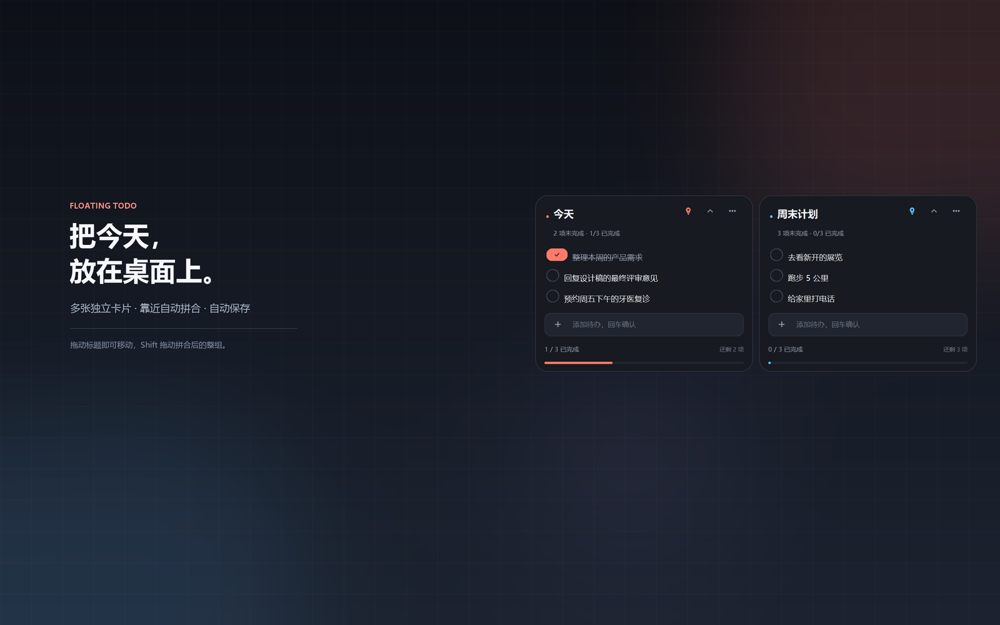
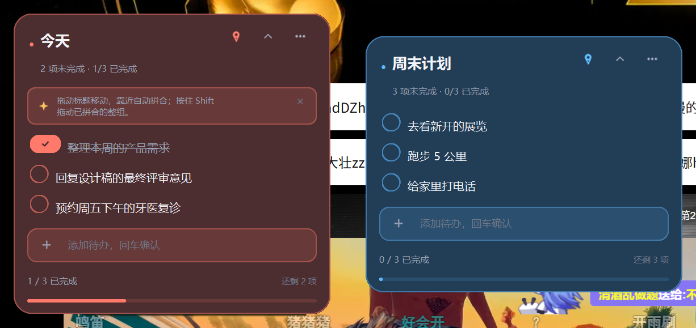

# 悬浮待办 · Floating Todo

把待办事项做成可以贴在桌面上的小卡片。每张卡都是一个独立清单，可以随意摆放；靠近时会磁吸拼合，按住 `Shift` 拖动则整组一起走。

深色雾面：



彩色玻璃：



## 功能

- **多卡自由摆放**：新建多张卡片，分别移动、折叠、置顶；重启后位置和内容自动恢复。
- **磁吸拼合**：卡片靠近彼此或屏幕边缘时自动对齐，拼合后的卡片间距统一；按住 `Shift` 拖动任意一张，整组同步移动。
- **Alt 微调**：拖动时按住 `Alt` 暂时关闭吸附，方便放在任意位置。
- **轻量任务操作**：圆形勾选框、双击任务编辑、悬停删除、回车快速添加；完成数与进度条实时更新。
- **六种强调色**：珊瑚、薄荷、天青、杏黄、紫藤、玫瑰，每张卡独立配色。
- **双主题外观**：默认深色雾面；在卡片菜单选择“切换为玻璃彩色背景”，六种强调色会变成对应的彩色磨砂玻璃观感（视觉拟态，不是系统窗口透明）。选择会自动保存。
- **安全持久化**：原子写入、自动备份；状态损坏时优先从 `.bak` 恢复，并把损坏文件留档。
- **单实例**：再次双击启动器不会开出第二份，只会把已有卡片唤醒到最前。
- **高 DPI 适配**：在 125% / 150% 缩放下保持清晰；支持多显示器工作区。

## 快速开始

环境：Windows 10/11，Python 3.11+（已在 Python 3.13.2 上验证）。

```text
双击 launchers\启动待办卡.vbs
```

启动器会优先使用 `pythonw.exe` 静默启动，不显示控制台窗口。如果 Python 不在 PATH 中，它会尝试 `pyw.exe -3`。

也可以从终端运行：

```powershell
cd floating-todo
python app.pyw
```

首次启动会在桌面右上角放一张「今天」空卡，并显示一条简短操作提示。

## 操作

| 操作 | 效果 |
| --- | --- |
| 拖动卡片标题区域 | 移动这张卡；靠近其他卡/屏幕边缘时吸附 |
| 按住 `Shift` 拖动 | 拖动已拼合的整组卡片 |
| 按住 `Alt` 拖动 | 临时关闭吸附，自由定位 |
| 点击任务左侧圆圈 | 完成 / 取消完成 |
| 双击任务文字 | 内联编辑 |
| 鼠标悬停任务 | 显示删除按钮 |
| 在底部输入框输入后按 `Enter` | 添加任务 |
| 双击卡片标题 | 重命名 |
| 右上角图钉 | 切换置顶 |
| 右上角箭头 | 折叠 / 展开卡片 |
| 右上角 `…` | 卡片菜单：新建、重命名、折叠、换色、切换玻璃/深色外观、清除已完成、删除、退出 |
| 点菜单外部 | 关闭卡片菜单 |
| `Ctrl+N` | 新建一张卡片 |

首次提示可以通过右侧的 `×` 关闭。删除最后一张卡、或在菜单中选择“退出悬浮待办”会结束程序。

## 数据位置

状态保存在：

```text
%APPDATA%\FloatingTodoCard\state.json
```

- `state.json.bak`：上一版自动备份。
- `state.corrupt-*.json`：检测到损坏时保留的原始文件。
- `app.log`：启动和异常日志。
- `wake.signal`：单实例唤醒信号。

坐标以物理像素保存，因此更换缩放在同一台显示器上也能恢复到合理位置；如果卡片落在当前离线显示器之外，会自动移回可见工作区。

## 项目结构

```text
floating-todo/
├─ app.pyw                     # 无控制台入口（先启用 DPI awareness）
├─ floating_todo/
│  ├─ app.py                   # 单实例、窗口管理、拖拽、菜单、持久化
│  ├─ card_window.py           # 单张卡片的窗口与交互
│  ├─ widgets.py               # 卡片 header、任务行、添加栏、菜单
│  ├─ models.py                # Card / Task / AppState
│  ├─ storage.py               # 原子保存、备份和恢复
│  ├─ snapping.py              # 磁吸几何与整组计算
│  ├─ platform_win.py          # DPI、Win32 窗口、工作区、互斥量
│  ├─ icons.py                 # Pillow 绘制的矢量风图标
│  ├─ typography.py            # 字体与两行截断
│  └─ constants.py             # 尺寸、颜色、限制
├─ launchers/
│  ├─ 启动待办卡.vbs            # 双击静默启动
│  └─ 调试启动.cmd              # 带控制台启动，便于排查
├─ tests/
│  ├─ test_models.py
│  ├─ test_storage.py
│  ├─ test_snapping.py
│  ├─ test_platform.py
│  └─ gui_smoke.py             # 真实 GUI 冒烟测试（会短暂显示窗口）
└─ docs/
   ├─ preview.png              # 深色雾面预览
   └─ preview-glass.png        # 彩色玻璃预览
```

## 开发与测试

```powershell
cd floating-todo
python -m pip install -r requirements.txt
python -m unittest discover -s tests -t . -v
python tests\gui_smoke.py
```

`gui_smoke.py` 使用独立的临时数据目录，不会读写你的真实待办数据；运行时会显示两张卡片并自动截图到 `artifacts/`。

## 已知限制

- 目前只提供 Python 源码运行方式，没有打包成 exe；目标机器需要安装 Python 和依赖。
- 没有系统托盘和开机自启，退出入口在卡片菜单里。
- 任务只能在卡片内部编辑，暂不支持跨卡片拖拽任务。
- 卡片拼合是磁吸布局，不会把多张卡的清单内容合并成一个数据对象。

## 依赖

见 `requirements.txt`：

- [CustomTkinter](https://github.com/TomSchimansky/CustomTkinter)
- [Pillow](https://python-pillow.org/)

图标和空状态插画都由 Pillow 在运行时绘制，不依赖外部图片资源。
